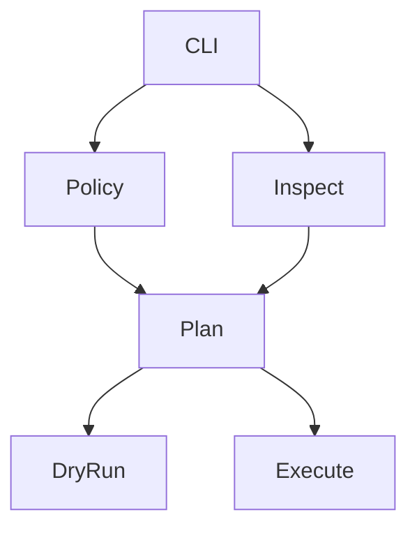

# registry-janitor

`registry-janitor` lists OCI registry tags and removes policy-selected manifests by digest.

[](https://github.com/mhrasoulian/registry-janitor/actions/workflows/ci.yml)

## What it does

A **tag** is a human-readable name that points to an OCI image manifest or index.
A **digest** is the content-addressed identifier of a manifest or index; multiple tags can point to the same digest.

The CLI lists tags and plans policy-based cleanup for OCI Distribution registries. Pruning is a dry run unless `--execute` is set. Execution deletes manifests by digest, so all tags that reference a deleted digest are affected.

## Quick start

The local demo requires Docker and Go. It publishes the registry on `localhost:5001`.

```sh
make up
make seed
make demo
make down
docker compose down -v
```

`make demo` output from the seeded local registry:

```text
REPOSITORY   TAG     DIGEST        CREATED               AGE   ACTION  REASON
demo/api     latest  sha256:294e9  2026-08-07T12:07:11Z  100d  keep    protected
demo/api     v0.7.0  sha256:0a9e1  2026-08-07T12:07:11Z  100d  delete  delete-candidate
demo/api     v0.8.0  sha256:ad0b3  2026-09-11T12:07:11Z  65d   delete  delete-candidate
demo/api     v0.9.0  sha256:2aa33  2026-10-11T12:07:11Z  35d   keep    keep_last
demo/api     v1.0.0  sha256:294e9  2026-08-07T12:07:11Z  100d  keep    protected
demo/worker  latest  sha256:76d0c  2026-08-07T12:07:11Z  100d  keep    protected
demo/worker  v0.7.0  sha256:bec8d  2026-08-07T12:07:11Z  100d  delete  delete-candidate
demo/worker  v0.8.0  sha256:25441  2026-09-11T12:07:11Z  65d   delete  delete-candidate
demo/worker  v0.9.0  sha256:6b17f  2026-10-11T12:07:11Z  35d   keep    keep_last
demo/worker  v1.0.0  sha256:76d0c  2026-08-07T12:07:11Z  100d  keep    protected

DRY RUN: nothing was deleted. Re-run with --execute to apply.
```

## How the policy decides

The example policy is in [`examples/policy.yaml`](examples/policy.yaml). Its fields are:

| Field | Type | Default | Meaning |
|---|---|---|---|
| `version` | integer | Required | Must be `1`. |
| `rules` | list | Required | One or more repository rules. |
| `match` | string | Required | Repository glob; the first matching rule is used. |
| `keep_last` | integer | Required | Keep at least this many newest tags; must be at least `1`. |
| `older_than` | duration string | None | Tags younger than this age are kept; supports day suffixes such as `30d` and Go durations. |
| `protect_tags` | list of regular expressions | None | Matching tag names are kept. Patterns are matched against the whole tag name. |

Evaluation order:

1. Select the first rule whose glob matches the repository. Repositories without a match are skipped.
2. Sort tags by creation time, newest first; ties are ordered by tag name.
3. Keep tags with unknown or epoch creation times and tags matching `protect_tags`.
4. Keep the first `keep_last` tags and any remaining tags younger than `older_than`.
5. Mark remaining tags as candidates, then keep candidates that share a digest with any kept tag.
6. If all tags would be deleted, keep the newest tag. Delete each remaining candidate digest once.

In the captured demo output above, each repository's `latest` and `v1.0.0` tags are protected and share a digest; `v0.9.0` is retained by `keep_last`; `v0.8.0` and `v0.7.0` are deletion candidates. The displayed ages vary by run.

## Command reference

Flags below are from `--help`.

### `list`

| Flag | Default | Meaning |
|---|---|---|
| `--registry` | None; required | Registry host and optional port. |
| `--repo` | None | Repository names; when omitted, use the registry catalog. |
| `--insecure` | `false` | Allow plain HTTP. |
| `--output` | `table` | Output format: `table` or `json`. |

### `prune`

| Flag | Default | Meaning |
|---|---|---|
| `--registry` | None; required | Registry host and optional port. |
| `--policy` | None; required | YAML policy file. |
| `--repo` | None | Repositories to inspect; when omitted, use the registry catalog. |
| `--insecure` | `false` | Allow plain HTTP. |
| `--execute` | `false` | Apply the plan instead of running a dry run. |
| `--max-delete` | `100` | Maximum unique repository/digest pairs to delete in one run. |
| `--output` | `table` | Output format: `table` or `json`. |

The registry client reads `REGISTRY_USERNAME` and `REGISTRY_PASSWORD` for authentication; if both are empty, it uses anonymous access.

| Exit code | Meaning |
|---|---|
| `0` | Command completed successfully. |
| `1` | A registry operation failed, tag inspection failed, or one or more manifest deletions failed. |
| `2` | A validated argument or policy is invalid, output format is unsupported, `--max-delete` is negative, or the deletion plan exceeds `--max-delete`. |

## Safety model

| ID | Invariant | Test |
|---|---|---|
| I1 | Prune defaults to dry run and does not call deletion. | `TestInvariant_I1_DryRunDefault` |
| I2 | Protected tags are never deleted. | `TestInvariant_I2_ProtectedTagsNeverDeleted` |
| I3 | The newest tag is never deleted. | `TestInvariant_I3_NewestTagNeverDeleted` |
| I4 | A digest is deleted only when all its tags are candidates. | `TestInvariant_I4_SharesDigestWithKeptTag` |
| I5 | Unknown or epoch creation times are never deleted. | `TestInvariant_I5_UnknownAgeNeverDeleted` |
| I6 | Repositories without a matching rule are skipped. | `TestInvariant_I6_NoMatchingRuleSkipped` |
| I7 | Exceeding `--max-delete` aborts before deletion. | `TestInvariant_I7_MaxDeleteAbortsBeforeDeletion` |
| I8 | An inspection failure skips that repository; other repositories continue. | `TestInvariant_I8_InspectionFailureSkipsRepositoryAndContinues` |

## Running in Docker

Build and inspect the image:

```sh
docker build -t registry-janitor:local .
docker run --rm registry-janitor:local --help
docker run --rm registry-janitor:local version
```

On macOS, `host.docker.internal` addresses the host from a container. For a read-only list against the local demo registry:

```sh
docker run --rm registry-janitor:local list --registry host.docker.internal:5001 --insecure --repo demo/api,demo/worker --output json
```

## Architecture



| Package | Responsibility |
|---|---|
| `cmd/registry-janitor` | CLI flags, policy loading, output, and exit codes. |
| `internal/policy` | YAML validation and tag decisions. |
| `internal/registry` | OCI catalog, tag inspection, authentication, and manifest deletion. |
| `internal/prune` | Repository inspection, plan construction, deletion limits, and execution. |
| `internal/output` | Stable table and JSON formatting. |
| `hack/seed` | Local-only synthetic demo images. |

## Limitations

- Deletion requires `REGISTRY_STORAGE_DELETE_ENABLED=true` in the registry.
- In the seeded registry run, `du -sh /var/lib/registry` reported 852.0K before pruning, 724.0K after pruning, and 628.0K after garbage collection. These are demo-specific measurements; garbage collection reduced usage further.
- Tag inspections run sequentially.
- For a multi-architecture index, creation time is taken from its first child image.
- If the registry catalog is disabled, pass repositories explicitly with `--repo`.
- The client uses OCI Distribution endpoints; it does not configure provider-specific cleanup policies for GitLab, Nexus, or Harbor.

## Troubleshooting

- A registry that rejects manifest deletion reports: `delete is not enabled for this registry: set REGISTRY_STORAGE_DELETE_ENABLED=true`.
- Port 5000 was occupied on this macOS host, so the local Compose demo uses host port 5001.
- Use `--insecure` for a plain-HTTP registry addressed by a non-localhost name. In the container test, `host.docker.internal` failed without this flag.

## Development

| Target | Action |
|---|---|
| `make build` | Build `bin/registry-janitor`. |
| `make test` | Run Go tests. |
| `make lint` | Run golangci-lint. |
| `make fmt` | Format Go files. |
| `make vet` | Run `go vet`. |
| `make up` | Start the local registry. |
| `make seed` | Push the synthetic demo images. |
| `make demo` | Run the dry-run against the demo repositories. |
| `make down` | Stop/remove Compose containers and network; keeps the volume. |
| `make clean` | Remove the local CLI binary. |

Run `go test -race -cover ./...`, `go vet ./...`, and `golangci-lint run ./...` to validate changes.

## License

See [`LICENSE`](LICENSE).
