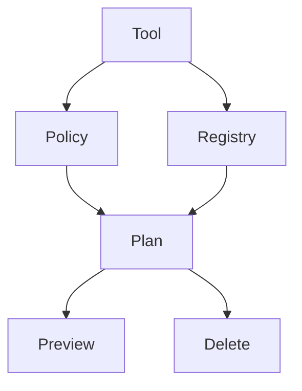

# registry-janitor

A command-line tool safely deletes old container images (packaged apps) from registries (storage servers), so they do not grow forever.

[](https://github.com/mhrasoulian/registry-janitor/actions/workflows/ci.yml)
CI means continuous integration: automated checks that run when code changes.

## The problem
- Every build in an automated pipeline sends a new image to storage.
- Older copies pile up when nobody removes them.
- Without cleanup, stored copies can use space without limit.
- Manual deletion is risky: removing the wrong copy can break a deployment that still needs it.
- One deletion can remove several version names at once.

## What this tool does
- Lists version names and creation times stored for selected apps.
- Applies a short policy file that you write.
- Shows a dry run (a preview that changes nothing) first; it deletes only with `--execute`.
This tool is for people who run their own container registry.

### What it will never do
- Delete the newest image in a repository (a named group of images).
- Delete a version name protected by your policy.
- Delete an image whose creation time is unknown.
- Delete an image still used by a kept version name.
- Start deleting when the plan exceeds `--max-delete`.
- Partly prune a repository when it cannot inspect one of its images.

## Key words
- **Registry:** a server that stores images and their version names.
- **Image:** a packaged application and the files needed to run it.
- **Tag:** a readable version name that points to an image.
- **Digest:** an identifier for the exact contents of an image.
A tag is a label on a box; a digest is the box's serial number.
Two labels can share one box; throwing it away removes both labels.

## Try it in 2 minutes
You need Go 1.22 or newer, Docker, and Docker Compose.
```sh
# Copy the project from GitHub.
git clone git@github.com:mhrasoulian/registry-janitor.git
# Enter the project directory.
cd registry-janitor
```
```sh
# Start the local demo registry.
make up
# Add sample images and version names.
make seed
# Preview the planned deletions.
make demo
```
`make demo` produced this table during a real run:
```text
REPOSITORY   TAG     DIGEST        CREATED               AGE   ACTION  REASON
demo/api     latest  sha256:05360  2026-08-07T12:45:55Z  100d  keep    protected
demo/api     v0.7.0  sha256:3e79c  2026-08-07T12:45:55Z  100d  delete  delete-candidate
demo/api     v0.8.0  sha256:0f355  2026-09-11T12:45:55Z  65d   delete  delete-candidate
demo/api     v0.9.0  sha256:0db60  2026-10-11T12:45:55Z  35d   keep    keep_last
demo/api     v1.0.0  sha256:05360  2026-08-07T12:45:55Z  100d  keep    protected
demo/worker  latest  sha256:45fbb  2026-08-07T12:45:55Z  100d  keep    protected
demo/worker  v0.7.0  sha256:d8720  2026-08-07T12:45:55Z  100d  delete  delete-candidate
demo/worker  v0.8.0  sha256:94d0e  2026-09-11T12:45:55Z  65d   delete  delete-candidate
demo/worker  v0.9.0  sha256:cb7c7  2026-10-11T12:45:55Z  35d   keep    keep_last
demo/worker  v1.0.0  sha256:45fbb  2026-08-07T12:45:55Z  100d  keep    protected

DRY RUN: nothing was deleted. Re-run with --execute to apply.
```
`ACTION` says whether the tool keeps, deletes, or skips a name; `REASON` explains why. The displayed digest is shortened; deletion uses the full value.
### Apply it for real
```sh
# Apply the plan to localhost:5001.
go run ./cmd/registry-janitor prune --registry localhost:5001 --insecure --policy examples/policy.yaml --repo demo/api,demo/worker --execute
```
The real run reported `deleted=4 failed=0 kept=6`.
### Clean up
```sh
# Stop the demo registry container.
make down
# Remove its stored demo data and network.
docker compose down -v
```

## How it decides what to delete
1. It applies the first policy rule that matches a repository name.
2. It keeps names with an unknown creation time or a date set to January 1, 1970.
3. It keeps names that match `protect_tags`.
4. It keeps the newest `keep_last` names, ordered by creation time.
5. It keeps remaining names younger than `older_than`, when that field is set.
6. It keeps a candidate image if any kept name points to the same digest.
7. It deletes each remaining digest once; if all names would be deleted, it keeps the newest.
The example policy in [`examples/policy.yaml`](examples/policy.yaml) targets the two repositories created by `make seed`:
```yaml
version: 1 # Required policy format version.
rules: # Rules are checked from top to bottom.
  - match: "demo/*" # Match repository names under demo/.
    keep_last: 1 # Keep the newest matching name.
    older_than: 30d # Keep other names younger than 30 days.
    protect_tags: # Always keep these names.
      - latest
      - '^v1\.0\.0$'
```
| Field | Meaning | Default | Required? |
|---|---|---|---|
| `version` | Policy format; must be `1`. | None | Required |
| `rules` | Ordered repository rules; at least one is needed. | None | Required |
| `match` | Repository-name pattern for this rule. | None | Required |
| `keep_last` | Minimum newest names to keep; must be at least `1`. | None | Required |
| `older_than` | Keep otherwise eligible names younger than this duration. | None | Optional |
| `protect_tags` | Names that always stay. Patterns match the full name. | None | Optional |
The demo policy protects `latest` and `v1.0.0`, then keeps the newest other name.
It marks two older names for deletion in each repository.

## Built with
| Technology | Version | Used for |
|---|---|---|
| Go | 1.22 | CLI and demo seeder. |
| `github.com/google/go-containerregistry` | 0.20.2 | Registry access and sample image publishing. |
| `github.com/spf13/cobra` | 1.9.1 | Commands and flags. |
| `gopkg.in/yaml.v3` | 3.0.1 | Reading YAML (a readable text format) policy files. |
| Docker, Docker Compose, `registry:2` | Docker and Compose unpinned; image `registry:2` | Local demo registry. |
| GitHub Actions | checkout v7, setup-go v7 | Automated checks and registry demo. |
| golangci-lint | v2.15.0, action v9 | Go lint checks in CI. |
| Make | Makefile | Build, test, lint, and demo commands. |

## Safety rules and how they are tested
<details>
<summary>Show safety rules and test names</summary>

| ID | Safety rule | Test |
|---|---|---|
| I1 | Pruning previews changes by default and makes no deletions. | `TestInvariant_I1_DryRunDefault` |
| I2 | Protected version names are never deleted. | `TestInvariant_I2_ProtectedTagsNeverDeleted` |
| I3 | The newest version name is never deleted. | `TestInvariant_I3_NewestTagNeverDeleted` |
| I4 | An image stays if any kept name points to it. | `TestInvariant_I4_SharesDigestWithKeptTag` |
| I5 | Images with unknown or epoch creation times stay. | `TestInvariant_I5_UnknownAgeNeverDeleted` |
| I6 | Repositories without a matching rule stay untouched. | `TestInvariant_I6_NoMatchingRuleSkipped` |
| I7 | A plan over `--max-delete` stops before any deletion. | `TestInvariant_I7_MaxDeleteAbortsBeforeDeletion` |
| I8 | An inspection failure skips that repository; other repositories continue. | `TestInvariant_I8_InspectionFailureSkipsRepositoryAndContinues` |
</details>

## Command reference
### `list`
| Flag | Default | Meaning |
|---|---|---|
| `--registry` | Empty; required | Registry host and optional port. |
| `--repo` | Empty | Names to inspect; omitted means all names the registry lists. |
| `--insecure` | `false` | Allow plain HTTP. |
| `--output` | `table` | Choose `table` or `json`. |
| `-h, --help` | `false` | Show command help. |
Table columns are `REPOSITORY`, `TAG`, `DIGEST`, and `CREATED`; JSON has `repository`, `tag`, `digest`, and `created`.
### `prune`
| Flag | Default | Meaning |
|---|---|---|
| `--registry` | Empty; required | Registry host and optional port. |
| `--policy` | Empty; required | Path to the YAML policy file. |
| `--repo` | Empty | Names to inspect; omitted means all names the registry lists. |
| `--insecure` | `false` | Allow plain HTTP. |
| `--execute` | `false` | Delete the planned images instead of previewing. |
| `--max-delete` | `100` | Maximum digest deletions in one run. |
| `--output` | `table` | Choose `table` or `json`. |
| `-h, --help` | `false` | Show command help. |
Prune tables show `REPOSITORY`, `TAG`, `DIGEST`, `CREATED`, `AGE`, `ACTION`, and `REASON`. JSON has `repository`, `tag`, `digest`, `created`, `age`, `action`, and `reason`.
Set `REGISTRY_USERNAME` and `REGISTRY_PASSWORD` for authentication. If both are empty, the client uses anonymous access.
| Exit code | Meaning |
|---|---|
| `0` | The command completed successfully. |
| `1` | A registry operation, inspection, repository inspection, or deletion failed. |
| `2` | Required arguments, policy, output format, or deletion limit are invalid; oversized plans also return this code. |

## Limitations
- Tested against Docker's `registry:2` and an in-memory test registry only.
- Deletion requires `REGISTRY_STORAGE_DELETE_ENABLED=true` on the registry.
- Registry garbage collection (removing files no longer referenced) may reclaim space after deletion.
- An earlier demo run measured 852.0K before pruning, 724.0K after pruning, and 628.0K after garbage collection.
- The tool inspects one tag at a time.
- Multi-architecture images (built for several processor types) use the first child image's creation time.
- If the registry cannot list repositories, pass `--repo` with the names to inspect.

## Troubleshooting
- If deletion is disabled, the tool says: `delete is not enabled for this registry: set REGISTRY_STORAGE_DELETE_ENABLED=true`.
- If macOS port 5000 is occupied, the Compose demo uses host port 5001.
- Docker containers need `--insecure` to reach this plain-HTTP demo through `host.docker.internal`.
  Without it, the reproduced error was `http: server gave HTTP response to HTTPS client`.

## How it works inside

| Package | Responsibility |
|---|---|
| `cmd/registry-janitor` | Command flags, policy loading, output, and exit codes. |
| `internal/policy` | Policy validation and keep/delete decisions. |
| `internal/registry` | Listing repositories and names, inspecting images, and deleting. |
| `internal/prune` | Building plans, enforcing limits, and executing deletions. |
| `internal/output` | Formatting table and JSON output. |
| `hack/seed` | Creating and publishing local demo images. |

## Development
| Target | Action |
|---|---|
| `make build` | Build `bin/registry-janitor`. |
| `make test` | Run Go tests. |
| `make lint` | Run golangci-lint. |
| `make fmt` | Format Go files. |
| `make vet` | Run `go vet ./...`. |
| `make up` | Start the local registry. |
| `make seed` | Publish demo images and names. |
| `make demo` | Preview pruning for the demo repositories. |
| `make down` | Stop containers and remove the Compose network. |
| `make clean` | Remove the local CLI binary. |
Run `go test -race -cover ./...`, `go vet ./...`, and `golangci-lint run ./...` to validate changes.

## License
See [`LICENSE`](LICENSE).
